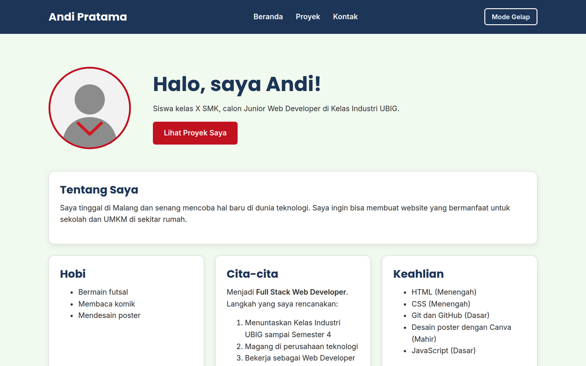

# Portofolio Andi Pratama

Website portofolio pribadi yang saya buat di Kelas Industri UBIG (Paket 1, Minggu 01 sampai 09).
Versi ini adalah **Portofolio v2**: tampil rapi di ponsel, tablet, dan laptop, serta interaktif dengan JavaScript.

## Tampilan

## Fitur

- Halaman **Beranda** berisi profil, hobi, cita-cita, jadwal belajar, dan daftar keahlian dari `data/keahlian.json` yang bisa ditambah
- Halaman **Proyek** berisi enam kartu proyek dari `data/proyek.json` dengan filter kategori, serta repositori GitHub terbaru dari GitHub API
- Halaman **Kontak** berisi form dengan penghitung karakter pesan
- Mode gelap di semua halaman
- Tampilan responsif dengan Flexbox dan *media query*

## Teknologi

- HTML5 dan CSS3 (Flexbox, *media query*, dan variabel CSS)
- JavaScript (DOM, *event*, `fetch`, dan `async`/`await`)
- JSON dan GitHub REST API
- Git, GitHub, dan Vercel

## Skor Lighthouse (mobile)

- Beranda: Performance 96, Accessibility 100, Best Practices 100, SEO 100
- Proyek: Performance 95, Accessibility 100, Best Practices 100, SEO 100
- Kontak: Performance 99, Accessibility 100, Best Practices 100, SEO 100

## Tautan

- Website: https://portofolio-andi-pratama.vercel.app
- Dibuat oleh: Andi Pratama, SMK Mitra
